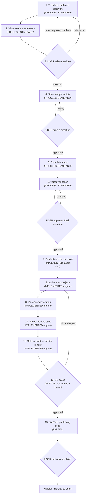

# COMPLETE WORKFLOW — the master operational reference

This is the single chronological document of the whole production system: **idea → published
content**. Read it once top to bottom before operating the pipeline. Each stage names its
inputs, its procedure (with the real commands and modules), its outputs, its approval gate,
and its failure modes. Stage-specific detail lives in the linked documents; this page keeps
the sequence, the gates, and the resume points.

Status labels — see the legend in [`INDEX.md`](INDEX.md):
**IMPLEMENTED** (code exists), **PARTIAL** (some steps automated),
**PROCESS-STANDARD** (a documented human/agent procedure, no tool yet), **PLANNED**.

## The pipeline diagram



The render stages 8–11 execute as **one command** in this engine (see
[Stage 11](#stage-11-video-assembly--rendering)) — the diagram keeps them separate because
each is a distinct concern with its own failure modes.

---

## Stage 1 — Trend research & content discovery

**Status: PROCESS-STANDARD** (no research tool exists in the repository — the agent performs
the research using whatever sources are reachable, and records findings in a file).

**Purpose.** Find animation content ideas that have evidence of audience interest — not
invented topics.

**Inputs.** Channel niche/positioning (from the user), optionally recent performance data the
user can share (views, retention, comments on past videos).

**Procedure.**

1. Research current YouTube trends in the niche: trending animation formats, storytelling
   formats that are performing, topics with search demand, recurring viral formats, and what
   is already saturated.
2. Use legitimate sources: YouTube search and channel pages, Google Trends where reachable,
   social platforms, public discussions. In a sandboxed agent environment, use the available
   web search tooling; where nothing is reachable, say so and mark the idea as
   **prediction-only** (no observed evidence).
3. For each candidate, record the evidence separately from the interpretation.
4. Write a research brief per idea to `runtime/work/ideas/<slug>.md` using the template in
   [`IDEA_RESEARCH.md`](IDEA_RESEARCH.md). One file per idea; the file is the stage's output.

**Outputs.** `runtime/work/ideas/<slug>.md` — idea briefs with evidence. (Stored in git-ignored
`runtime/work/`; promote the selected one's brief into the film folder under `deliverables/<film>/` at
delivery, if the user wants it archived.)

**Approval gate.** None here — research and evaluation run, then the user chooses at Stage 3.

**Failure modes.**

- *No research sources reachable* → proceed with prediction-only ideas, label them, and tell
  the user the evaluation rests on judgment, not data.
- *Evidence collected but stale* → record the observation date in the brief; older than a
  month is a warning, not a blocker.

**Never guarantee virality** — see [`VIRAL_POTENTIAL_EVALUATION.md`](VIRAL_POTENTIAL_EVALUATION.md).

---

## Stage 2 — Viral-potential evaluation

**Status: PROCESS-STANDARD.**

**Purpose.** Score each researched idea on ten transparent criteria so the user chooses
between *evaluated* ideas, not a random list.

**Procedure.** Apply the rubric in [`VIRAL_POTENTIAL_EVALUATION.md`](VIRAL_POTENTIAL_EVALUATION.md):
score hook strength, curiosity/emotional appeal, audience relevance, shareability,
storytelling potential, visual entertainment value, retention potential, originality, trend
relevance, and production feasibility (each 1–5, weighted). Compute the weighted total and
write the reasoning per criterion into the idea brief. Production feasibility is scored
**against this engine's real capabilities** — a brilliant idea the engine cannot render
(3D, crowds, real likenesses — see [`universal_toolbook/process/08_LIMITS.md`](../../universal_toolbook/process/08_LIMITS.md))
scores low on feasibility and that must be visible.

**Outputs.** Updated `runtime/work/ideas/<slug>.md` files with score tables.

**Approval gate.** None — feeds Stage 3.

---

## Stage 3 — Present ideas; user selects

**Status: PROCESS-STANDARD. This is a hard human gate.**

**Purpose.** Present the strongest curated set (typically 3–5, never a dump) and let the user
decide.

**The user may:** select an idea · request more ideas · reject all · ask for improvements ·
combine compatible ideas · change the topic · request a different animation style.

**Procedure.** Present each shortlisted idea as: title, one-paragraph concept, target
audience, why people might watch it, the opening hook, suggested style (`cel` or
`parchment` — see [`universal_toolbook/process/01_INTAKE.md`](../../universal_toolbook/process/01_INTAKE.md)),
storytelling format, estimated duration, supporting evidence, competition notes, weaknesses,
and the viral-potential score with its explanation.

**On selection**, the selected brief (plus its research context) is copied to
`runtime/work/<slug>/idea.md` and stays with the project through every later stage. The brief is
referenced — not re-derived — when writing scripts and choosing style.

**Outputs.** `runtime/work/<slug>/idea.md` (selected idea + research + scores).

**Rule.** No full-video production starts before this gate resolves.

---

## Stage 4 — Generate short sample scripts

**Status: PROCESS-STANDARD.**

**Purpose.** Before committing to a full script, show the user 2–3 *short* samples (≤ ~15
sentences each) that explore different storytelling approaches: fast-paced,
curiosity-driven, humorous, dramatic/suspenseful, educational — whichever fit the concept
(do not force a style that does not fit).

**Each sample shows:** opening hook, story direction, narration style, main concept, a
potential ending. Samples are previews — they are not timed, not scene-planned, not polished.

**Procedure.** Write samples to `runtime/work/<slug>/samples/` (one file each). Present them; the user
picks one direction, asks for a revision, or mixes elements.

**Outputs.** `runtime/work/<slug>/samples/sample_*.md` + the user's choice recorded in
`runtime/work/<slug>/decisions.md`.

**Approval gate.** USER picks a direction (or requests revision — loop back).

---

## Stage 5 — Generate the complete script

**Status: PROCESS-STANDARD** (generation is by the agent; *scene planning* has tooling —
see below).

**Purpose.** The full narration, sized for the intended duration and delivery format.

**Procedure.**

1. Fix the delivery target first: duration (e.g., 40–90 s short-form, ≤ 180 s Shorts, or
   long-form) and aspect (16:9 / 9:16) — the rules in
   [`universal_toolbook/process/01_INTAKE.md`](../../universal_toolbook/process/01_INTAKE.md)
   govern (short-form gate, Shorts profile).
2. Budget duration from words: ≈ **2.5 words/second** of speech plus pauses; a scene adds
   ~1.3 s of lead-in/tail-out. Write the script to fit the budget, not the other way round.
3. Structure the script as scenes (one location + one continuous stretch of time; one
   meaningful change per scene), with a strong opening hook, natural progression, and an
   ending that earns it. No padding narration to hit duration.
4. Save the complete script to `runtime/work/<slug>/script_v1.md`.
5. If a raw script was supplied **verbatim** by the user, it is the source of truth and the
   engine can enforce 100 % preservation (Stage 6 explains the mechanism).

**Optional automation (IMPLEMENTED).** `python3 universal_toolbook/tools/script_helper.py parse
<raw_script.txt> --out runtime/work/<slug>/skeleton.json` segments a raw script into beat-aligned
scene skeletons (~34 words/scene) with a duration estimate and a BGM recommendation, and
`python3 universal_toolbook/tools/script_helper.py verify <raw_script.txt> <episode.json>`
checks word-for-word fidelity. The skeleton is a *starting point* (generic cast/settings);
the agent still authors the real cast, environments, props, boards, and camera per
[`universal_toolbook/process/01_INTAKE.md`](../../universal_toolbook/process/01_INTAKE.md).

**Outputs.** `runtime/work/<slug>/script_v1.md` (the complete script).

**Approval gate.** Soft — the user sees the script at Stage 6's approval (final narration).

---

## Stage 6 — Polish the script for AI voiceover

**Status: PROCESS-STANDARD.** The standard is the codified prompt
[`prompts/VOICEOVER_POLISH_PROMPT.md`](prompts/VOICEOVER_POLISH_PROMPT.md) — the repository's
single authoritative voiceover-editing standard. Do not substitute a weaker summary of it.

**Purpose.** Make the script read naturally through a neural voice: conversational English,
right sentence lengths, punctuation that creates real pauses, spoken numbers,
pronunciation-safe terminology — while preserving the original tone and meaning.

**Procedure.**

1. Apply the polish prompt to the complete script.
2. Keep **both** versions: original at `runtime/work/<slug>/script_v1.md`, polished at
   `runtime/work/<slug>/script_polished.md` (the version the engine will speak).
3. **Verbatim scripts.** If the user's script must be preserved 100 %, polish is constrained
   to punctuation and pause shaping (the engine's fidelity check, `validate --script`,
   compares word tokens and ignores punctuation — so `just... started` → `just started`
   stays faithful, but changing a word does not). If word-level changes are needed for TTS,
   present the change to the user and record the approval in `runtime/work/<slug>/decisions.md`.
   See [`SCRIPT_WORKFLOW.md`](SCRIPT_WORKFLOW.md) for the exact fidelity semantics.
4. Present the polished narration to the user.

**Outputs.** `runtime/work/<slug>/script_polished.md`.

**Approval gate. HARD.** The user approves the final narration **before** any expensive
production stage. Rendering, re-rendering, and voice generation all consume this text;
changing it later invalidates the voice cache and retimed timeline.

---

## Stage 7 — Decide the best generation order (audio-first vs animation-first)

**Status: IMPLEMENTED** — the decision logic is fixed by how the engine works; this stage
records the decision and its reasoning for each project.

**The question the user asked the pipeline to answer:** must audio come first, or animation?
For this engine the answer is **audio-first, always** — because the *true* duration of the
film is created by the voiceover pass, and every visual element (scene length, camera cut,
board reveal, foley cue, subtitle) is then locked to the measured speech. Details, the
approach comparison (A / B / hybrid), and the one exception (user-supplied external audio)
are in [`AUDIO_VISUAL_SYNCHRONIZATION.md`](AUDIO_VISUAL_SYNCHRONIZATION.md).

**Procedure.** Confirm the chosen order in `runtime/work/<slug>/decisions.md`:

- *Default:* audio-first — generate voiceover, then author/lock visuals to the measured
  timing (Stages 8–10).
- *Exception:* if the user supplies their own recorded narration, render with
  `--voice-dir <dir>` (files named `S01.wav`… per scene) and author visuals against those
  measured durations.

**Outputs.** The decision line in `runtime/work/<slug>/decisions.md`.

---

## Stage 8 — Voiceover generation

**Status: IMPLEMENTED.** Deep detail: [`VOICE_GENERATION.md`](VOICE_GENERATION.md) and
[`universal_toolbook/process/05_AUDIO.md`](../../universal_toolbook/process/05_AUDIO.md).

**What happens.** Inside `render`, `universal_toolbook/engine/voice_engine.py`
(`prepare_episode_voiceover`) synthesizes **one audio file per dialogue line** with the
resolved backend (Edge neural → Piper offline fallback per line → OS TTS last resort →
external files), compacts internal TTS dead air, extracts **exact word timestamps**, and
writes the per-line WAVs plus `vo_manifest.json` into the render's work directory
(`runtime/renders/.work_<stem>/vo_cache/`).

**Inputs.** The approved polished script (inside `episode.json`), the `voices` map,
`pause_after` values, backend choice (`--voice auto` is the default in restricted networks).

**Voice consistency.** Each speaker id maps to exactly one voice model for the whole film;
per-line synthesis reuses the same model, so the narrator is consistent across scenes by
construction. Changing a line's text invalidates only that line's cache (hash-keyed — see
`VOICE_GENERATION.md`), not the rest.

**Failure modes.** Silent master → the render exits **3** with `status: COMPLETE_SILENT` and
a `voice_diagnosis` list; fix the backend and re-render (never deliver). Two characters
sounding alike → `voice_backend` in the report shows one model; assign distinct voices.

**Approval gate.** None (the narration was approved at Stage 6; the *render* of it is
checked at Stage 12).

---

## Stage 9 — Animation generation (episode authoring)

**Status: IMPLEMENTED.** Deep detail: [`ANIMATION_GENERATION.md`](ANIMATION_GENERATION.md),
[`universal_toolbook/process/02_AUTHORING_EPISODE_JSON.md`](../../universal_toolbook/process/02_AUTHORING_EPISODE_JSON.md),
and the full schema in [`universal_toolbook/01_TOOLBOOK_REFERENCE.md`](../../universal_toolbook/01_TOOLBOOK_REFERENCE.md).

**Important framing.** This engine does **not** use neural video-generation models.
"Animation generation" = **authoring a scene graph (`episode.json`) that a deterministic
2.5D renderer executes**: 60 biomechanical actions, 12 preset environments (or parametric
settings), a fixed prop/board library, two visual styles (`cel`, `parchment`). Character
consistency is structural — one `cast` entry, referenced by id in every scene.

**Procedure.**

1. `cp universal_toolbook/templates/episode_minimal.json runtime/work/<slug>/episode.json` (or a
   relevant `examples/*.json` for pacing).
2. Author cast (distinct build/hair/colour/scale per character), voices, scenes: location,
   beats with `from_x`/`to_x` blocking, `camera_shots` cued on exact spoken phrases,
   `boards` with `cue_on`, `props`, `accent_words`, `dialogue[]` (one sentence per entry,
   ≤ 46 chars where possible).
3. `python3 universal_toolbook/run_studio.py validate runtime/work/<slug>/episode.json` → must print
   `warnings: []`. Add `--script runtime/work/<slug>/script_polished.md` for verbatim fidelity.
4. **Stills loop (the cheap QA):** `python3 universal_toolbook/run_studio.py stills
   runtime/work/<slug>/episode.json --out-dir runtime/work/<slug>/stills_16x9 --width 1920 --height 1080`
   (and `--width 1080 --height 1920` for portrait delivery). **Look at every still** —
   anatomy, occlusion, spacing, subtitles — fix, repeat. Two to three rounds is normal.
5. Draft render to check mid-scene cues (boards, camera cuts):
   `python3 universal_toolbook/run_studio.py render runtime/work/<slug>/episode.json
   --out /tmp/draft/film_draft.mp4 --draft --voice auto --workers 2 --chunk-sec 20` and
   inspect a frame at every `cue_on + 1.5 s` (boards) and `cue_on + 2.5 s` (cuts).

**Outputs.** `runtime/work/<slug>/episode.json` + stills in `runtime/work/<slug>/stills_*/`.

**Failure modes.** Action typo → silent standing idle (looks frozen, not broken). Board
never appears → `cue_on` phrase not spoken verbatim. Seated pose on standing actor → floating
squat. All covered in
[`universal_toolbook/process/07_TROUBLESHOOTING.md`](../../universal_toolbook/process/07_TROUBLESHOOTING.md).

---

## Stage 10 — Audio–visual synchronization

**Status: IMPLEMENTED.** Deep detail: [`AUDIO_VISUAL_SYNCHRONIZATION.md`](AUDIO_VISUAL_SYNCHRONIZATION.md).

**What happens automatically, after voice generation:**

- Scenes are **retimed to measured speech** (`voice_engine.py` + `episode.js`); declared
  `duration` was only a plan. Beats scale with the new length.
- Boards (`cue_on`/`hide_on`) and camera shots (`cue_on`) snap to the **exact spoken phrase**.
- Subtitles carry per-word timestamps → the glowing active-word highlight follows real speech.
- Mouth movement is an **amplitude-based viseme** (reads as "talking", not phoneme-exact).
- Foley events are derived from scene actions/weather into `*_visual_audio_cues.json`.
- The mixer ducks BGM −9.5 dB under phrases; `bgm_gain` 0.86–0.92 keeps narration on top.

**Handling short/long scenes.** If narration runs shorter than declared, the scene shortens
and beats compress; if longer, it stretches. A `min_duration` floor exists; for short-form
deliveries the final duration is *gated* after retiming (`--short-form` 40–90 s,
`--shorts` ≤ 180 s) and the render refuses to encode out-of-range films
(`INVALID_SHORT_FORM_DURATION` / `INVALID_SHORTS_DURATION`) rather than truncate dialogue.

**Outputs.** `episode_retimed.json` (in the render work dir) — the timeline the renderer
consumes; nothing for the user to handle.

---

## Stage 11 — Video assembly & rendering

**Status: IMPLEMENTED.** Deep detail: [`VIDEO_ASSEMBLY.md`](VIDEO_ASSEMBLY.md) and
[`universal_toolbook/process/03_RENDER_PIPELINE.md`](../../universal_toolbook/process/03_RENDER_PIPELINE.md).

**The master command** (landscape; use `--aspect-ratio 9:16` for portrait):

```bash
python3 universal_toolbook/run_studio.py render runtime/work/<slug>/episode.json \
  --aspect-ratio 16:9 --out runtime/renders/<slug>_master_16x9.mp4 --full --preset veryfast \
  --crf 24 --chunk-sec 45 --workers 2 --resume --voice auto
```

**What it does, in order:** voice pass (cached per line) → compile timeline via Node
(`universal_toolbook/engine/episode.js`) → duration gate if short-form/Shorts → parallel
chunked frame rendering (`universal_toolbook/engine/video_renderer.js`) → ffmpeg concat →
mix (`universal_toolbook/engine/audio_mixer.py` → `master_audio.wav`) → mux → writes:

- `runtime/renders/<slug>_master_16x9.mp4` — the master
- `..._chapters.txt` — YouTube-chapter timestamps + auto-generated CC music credits
- `..._report.json` — resolution, fps, duration, `voice_backend`, BGM, warnings, `voiced`
- `..._validation_report.json` — `valid`, `frames`, `dimensions`, `film_grain`, `voiced`, `warnings`
- `..._visual_audio_cues.json` — every foley/visual cue
- `runtime/renders/.work_<stem>/` — `master_audio.wav`, chunks, voice cache (build artifacts; git-ignored)

**Resume.** Re-run the *same* command after an interruption — `--resume` reuses finished
chunks. If you edited `episode.json`, delete `runtime/renders/.work_<stem>/` first (chunks are
content-blind), or you will mix old and new frames.

**Measured timing (2-vCPU sandbox, landscape):** ~90 s per 2-minute film at master quality;
draft ~50 s; stills ~2 s.

**Approval gate.** None by itself — the draft/stills reviews *are* the gates feeding Stage 12.

---

## Stage 12 — Quality control

**Status: PARTIAL** — automated gates + mandatory human review. Deep detail:
[`QUALITY_CONTROL.md`](QUALITY_CONTROL.md) and the definition-of-finished checklist in
[`universal_toolbook/process/06_QA_GATE.md`](../../universal_toolbook/process/06_QA_GATE.md).

**Automated (engine + tools):** `validate` warnings; `validation_report.json`
(`valid`, `frames ≈ duration × 30`, `film_grain: false`, `voiced: true`, `warnings: []`);
the `COMPLETE_SILENT` exit-3 gate; full-decode check
(`ffmpeg -v error -i <master> -f null -` prints nothing); audio measurement of
`master_audio.wav` (peak −3…−1 dBFS, RMS −16…−19 dBFS); optional
`python3 tools/subtitle_check.py`, `python3 tools/audio_report.py`, `python3 tools/mix_probe.py`;
the regression suite (`node tests/regression/run_all_tests.js`, `python3 tests/integration/test_studio_pipeline.py`)
and CI (`.github/workflows/verify.yml`).

**Human (mandatory):** look at ≥ 10 frames across the timeline (start, each scene head,
every board, ending); watch the draft for cue timing; listen for clipped words, wrong
pronunciation, BGM pumping at scene joins; confirm aspect/duration match the delivery target;
check chapters timestamps and CC credits.

**Approval gate. HARD.** The user previews and approves the finished video before any
publishing preparation.

**On failure:** fix in `episode.json` (Stage 9), re-validate, stills, draft, master — in
that order. The stills/draft loop is cheap; a broken master is not.

---

## Stage 13 — YouTube publishing preparation

**Status: PARTIAL** — preparation tooling exists, platform publishing does not (no YouTube
API integration; the user uploads). Deep detail: [`YOUTUBE_PUBLISHING.md`](YOUTUBE_PUBLISHING.md).

**What the pipeline already produces:**

- `*_chapters.txt` in **YouTube chapter format** (generated from scene starts).
- CC music credits appended to the chapters file — paste into the description.
- Delivery channels: master in `runtime/renders/`, mirror in `deliverables/<film>/` (per
  [`deliverables/RESULTS.md`](../../deliverables/RESULTS.md)), a download page
  (`deliverables/the_wall_you_agreed_with/index.html` + `python3 tools/serve_downloads.py 8000 deliverables/the_wall_you_agreed_with`),
  an HTML player (`python3 universal_toolbook/run_studio.py player <master> --out
  runtime/renders/player.html`), an SVG storyboard
  (`python3 universal_toolbook/tools/build_storyboard_svg.py <master> --out
  deliverables/<film>/storyboard.svg`), and a 1920×1080 poster drawn from a real film frame
  (`node tools/make_poster.js <hero.png> <out-dir> <stills...>`).

**What the agent prepares for the user (manual upload):** a title, a description built from
the film's actual `thesis` + chapters + credits (honest, no keyword stuffing, no clickbait),
the master file, the poster (crop to 1280×720 if desired), and suggested tags. The metadata
document goes to `deliverables/<film>/publishing.md`.

**Approval gate. HARD.** Nothing is published, pushed, or uploaded without the user's
explicit authorization. This matches the ASK-FIRST tier of
[`AGENTS.md`](../../AGENTS.md).

---

## Automation vs human — the boundary table

| Stage | Automated | Requires the user |
| --- | --- | --- |
| 1 Research | agent runs the research | provides niche, past performance data |
| 2 Evaluation | agent scores per rubric | — |
| 3 Selection | presentation | **chooses** (select / more / reject / improve / combine / re-top) |
| 4 Samples | agent writes | **picks a direction** |
| 5 Script | agent writes; `script_helper.py` parses/verifies | provides verbatim script if applicable |
| 6 Polish | agent applies the polish prompt | **approves final narration** |
| 7 Order | decision logic fixed by engine | supplies external audio for the exception path |
| 8 Voice | engine | — |
| 9 Animation | engine renders; agent authors JSON | — |
| 10 Sync | engine | — |
| 11 Assembly | engine | — |
| 12 QC | automated gates | **reviews & approves** the video |
| 13 Publishing | metadata + delivery prep | **authorizes** and performs the upload |

Stages that can be **skipped**: 1–3 when the user already has a chosen, approved idea
(record it in `runtime/work/<slug>/idea.md` anyway — it is the project's memory). 4 when the user
approves the complete script direction up front. Nothing else: Stage 6 approval, Stage 12
review, and Stage 13 authorization are never skipped.

## Resuming from the last successful stage

The pipeline is file-based, so resuming means checking which stage's output files exist:

| You resume when… | Pick up at | Because |
| --- | --- | --- |
| `runtime/work/<slug>/idea.md` missing | Stage 1 | no project memory exists |
| `idea.md` exists, no `script_polished.md` | Stage 4 or 5 | idea approved, script not done |
| `script_polished.md` exists, no approved `decisions.md` entry for it | Stage 6 gate | narration not yet approved |
| approved script, no `episode.json` | Stage 9 | authoring not started |
| `episode.json` valid, no master | Stage 9 stills loop (or 11 if stills/draft already passed) | the cheap QA loop first |
| master exists but QC not signed off | Stage 12 | review pending |
| QC approved, no `deliverables/<film>/` set or `publishing.md` | Stage 13 | packaging not done |

Within the render itself, `--resume` handles interrupted encoding (see Stage 11). The
voice cache (`runtime/renders/.work_<stem>/vo_cache/`) means an interrupted or repeated render never
re-synthesizes unchanged lines.
