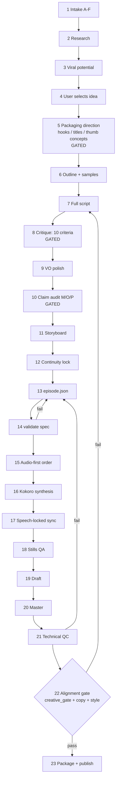

# MASTER PROMPT — the operating manual for this repository

**Read this file first. It is the authoritative entry point for every AI agent and every session.**

| | |
|---|---|
| **Repository** | BIRAL0-0/Universal_Animation_Toolbook (GitHub) |
| **This file's job** | eliminate rediscovery. Every fact here was extracted from the repository itself — `--help` output, source code, config files and shipped artifacts — not from memory or intention |
| **Status of this file** | `PROCESS-STANDARD`, versioned with the repo. It is not generated; it is maintained by hand and gated by `tools/check_docs.py` |
| **Authority order** | source code > config files > this file > `AGENTS.md` > other docs. **When this file and the code disagree, the code is right and this file is a bug** |
| **Verified against** | branch `arena/b4a29d97-universal-animation-toolbook` from `1eb3c5b`, 2026-11-11 |

If you have read only one section of this file, read §1 (truth about this repository) and §3
(the commands). Those two sections prevent the two failure modes that waste the most time:
believing documentation that describes code which does not exist, and inventing CLI flags.

---

## 1. The truth about this repository

Six things are stated here because getting them wrong costs a session. Each was verified by
running the code, not by reading a doc.

1. **There is no `projects/` directory, and there never was in any commit.** `scripts/new_project.py`
   creates one on demand, `tools/produce_video.py` requires one, and `scripts/new_project.py` is
   verified working — but **all eight shipped films were made by the episode route**: hand-authored
   `episode.json` → `universal_toolbook/run_studio.py render` → files filed into `videos/<slug>/`.
   The episode route is the **standard workflow** (§3.4). The project route is a *supported scaffold*
   for long multi-session productions, not the default and not a description of the past.
2. **The renderer is a hand-built Node canvas engine.** It is not Remotion and must not become
   Remotion. `docs/decisions/ADR-0001-remotion-evaluation.md` records why.
3. **`videos/` is the only directory that holds finished work.** `deliverables/` holds historical
   hand-off artifacts. Everything else is code, docs, tests or tools.
4. **The format rule is automatic and has exactly one boundary**, `FORMAT_DURATION_BOUNDARY_SEC = 60.0`
   in [`universal_toolbook/run_studio.py`](universal_toolbook/run_studio.py) (line 77). `< 60 s` → portrait 1080×1920. `>= 60 s` → landscape
   1920×1080. 59 s is portrait; exactly 60 s is landscape. Three shipped films carry a recorded,
   approved exception (§5).
5. **There is no analytics access.** No CTR, retention or view number in this repository is measured.
   Predictions are labelled `[P]` and may never be presented as fact.
6. **A passing gate is not a quality claim.** The gates prove a process ran and a claim is honest.
   They cannot prove a film is good or that a thumbnail will earn a click. Say so plainly.

---

## 2. Part 1 — Operating principles and architecture

### 2.1 Purpose and the ten operating principles

**Purpose of this repository:** produce complete, identifiable, searchable animated videos —
film, voice, subtitles, music, thumbnail, title, description, metadata and record — from a single
topic, repeatably, with every artifact traceable.

The ten principles below are not aspirations. Each one exists because violating it caused a
specific, documented failure.

| # | Principle | The failure it prevents |
|---|---|---|
| 1 | **The repository is the only source of truth.** Verify a flag by running `--help`. Verify a path by `ls`. Never document from memory. | Documentation claiming features that do not exist |
| 2 | **Never invent a CLI flag, module responsibility, path or feature.** If it is not in `--help` or the source, it is not real. | A session that "documents" imaginary tooling |
| 3 | **Never describe planned work as available.** Label it `PLANNED`. | Readers trusting a roadmap as a manual |
| 4 | **A decision needs a rejected alternative.** If nothing was rejected, nothing was chosen. | Defaults passed off as designs (the reason `creative_gate.py` exists) |
| 5 | **Never delete the only copy.** Not of a video, script, asset or benchmark. Migrations copy, verify, then retire. | Irrecoverable loss of produced work |
| 6 | **Prove it, do not assert it.** Run the gate, look at the frames, read the audio numbers. | "Should work" reported as "works" |
| 7 | **Look at many frames, not the first and the last.** Inspect the middle, the transitions and the seams. | Renders that pass every check the eye would fail |
| 8 | **Label every claim** `[M]` measured, `[O]` observed, `[P]` predicted. | Fabricated credibility |
| 9 | **One promise, three surfaces.** Title, thumbnail and hook must all make the same promise. | Baited clicks and wasted surfaces |
| 10 | **Write the fix down as a test and a skill update.** Fix → regression test → skill. | The same bug costing a second session |

### 2.2 Repository architecture map

Every top-level entry, what it is responsible for, when to use it, and whether it is permanent.

| Location | Responsibility | When to use | Lifetime |
|---|---|---|---|
| `master_prompt.md` | **This file.** The operating manual | Always, first | Permanent |
| `START_HERE.md` | Short compatibility redirect | Historical links only | Permanent, frozen |
| `AGENTS.md` | Agent contract: architecture table, skill map, auto-video rule, gates, git rules | Every session, after this file | Permanent |
| `AGENT_OPERATING_RULES.md` | Terse behavioural rules | When behaviour is in question | Permanent |
| `README.md` | Human-facing overview, install, quick start | Humans, and to orient | Permanent |
| `CHANGELOG.md` | Release-level history | Before claiming a version | Permanent |
| `CONTRIBUTING.md` | Contribution and PR expectations | Before opening a PR | Permanent |
| `universal_toolbook/` | **The renderer.** Engine, process, TTS, config, assets, skills-adjacent templates | Every production run | Permanent |
| ├ `run_studio.py` | The single CLI orchestrator: `check bgm-list validate stills render player` | Every render | Permanent |
| ├ `engine/` | Node canvas compositor: characters, props, camera, subtitles | Changing how things draw | Permanent |
| ├ `process/` | Python pipeline: voices, assembly, timing | Changing how a run is orchestrated | Permanent |
| ├ `tts/` | TTS providers and [`universal_toolbook/tts/config/voices.json`](universal_toolbook/tts/config/voices.json) | Voice behaviour | Permanent |
| └ `config/` | [`studio_config.json`](universal_toolbook/config/studio_config.json): format policy, defaults, single source for policy numbers | Changing any policy | Permanent |
| `videos/` | **Every finished video**, one `<slug>/` dir each, plus `index.json` and `PUBLISHING_KIT.md` | Finding, checking, publishing work | Permanent |
| `skills/` | 17 permanent skills: procedural and domain knowledge for agents | Before doing any specialist task | Permanent |
| `docs/` | Explanations: architecture, production, decisions, development | When you need *why* | Permanent |
| `templates/` | [`MASTER_VIDEO_PRODUCTION_PROMPT.md`](templates/MASTER_VIDEO_PRODUCTION_PROMPT.md) and [`templates/VIDEO_PROJECT_TEMPLATE/`](templates/VIDEO_PROJECT_TEMPLATE/README.md) | Starting a new production | Permanent |
| `tools/` | 20 standalone checkers/builders, each independently runnable | Verification, packaging, analysis | Permanent |
| `scripts/` | `new_project.py` (scaffold), `verify_fresh_checkout.py` (CI clone test) | Starting a project route, validating a clone | Permanent |
| `examples/` | 14 validated episode specs, the reference corpus for `validate_specs.py` | Copying a working spec | Permanent |
| `tests/` | `unit/`, `production/`, `integration/`, `regression/` | Before and after any change | Permanent |
| `deliverables/` | Historical hand-off packages (142 MB) | Only to recover an old artifact | Permanent, frozen — do not add to it |
| `runtime/` | Scratch: work dirs, audit notes | During a production run | **Temporary** — gitignored except `README.md` |
| Python bytecode caches and `node_modules/` | Build artifacts, created by running anything | Never | **Temporary** — never commit |
| `projects/` | **Does not exist.** Created on demand by `scripts/new_project.py` | Only for long multi-session productions (§3.5) | **Temporary** — `projects/video-*` is gitignored |

Rules that follow from the map:

- **Put finished work in `videos/<slug>/`.** Nothing else is a deliverable.
- **Never commit `runtime/`, caches, renders-in-progress or `projects/video-*`.**
- **`deliverables/` is frozen.** It is evidence of what was handed over, not a drop zone.
- **A new top-level directory requires updating `tools/validate_structure.py`** (`REQUIRED_DIRS`)
  or the structure gate will not know about it.

### 2.3 The exact production architecture — 23 stages

The pipeline is 23 stages grouped into six phases. Status labels are exact and matter:

- **IMPLEMENTED** — code performs it; a command does it.
- **GATED** — code checks that a human/agent did it properly (it cannot do it).
- **PARTIAL** — some steps automated.
- **PROCESS-STANDARD** — a documented procedure executed by an agent or human; no tool performs it.
- **PLANNED** — does not exist. Do not rely on it.

| # | Stage | Status | Performed by | Output artifact |
|---|---|---|---|---|
| **A. Decide** | | | | |
| 1 | Intake classification (A–F) | PROCESS-STANDARD | agent | intake note in the record |
| 2 | Topic research | PROCESS-STANDARD | agent (+ `web_search`) | `docs/production/IDEA_RESEARCH.md` procedure |
| 3 | Viral-potential evaluation | PROCESS-STANDARD | agent | `docs/production/VIRAL_POTENTIAL_EVALUATION.md` rubric |
| 4 | Idea shortlist and user selection | PROCESS-STANDARD | agent → user | chosen topic |
| 5 | **Packaging direction** (hook / title / thumbnail concepts) | GATED | agent, checked by `tools/creative_gate.py` | `creative` block in `record.json` |
| **B. Write** | | | | |
| 6 | Script outline + short samples | PROCESS-STANDARD | agent → user | outline |
| 7 | Full script | PROCESS-STANDARD | agent | `script.md` |
| 8 | Script critique, 10 criteria, revision | GATED | agent, checked by `creative_gate.py` | `creative.script_critique` |
| 9 | Voiceover polish (byte-identical standard) | PROCESS-STANDARD | agent | `docs/production/prompts/VOICEOVER_POLISH_PROMPT.md` applied |
| 10 | Claim audit and fact check | GATED | agent, checked by `creative_gate.py` | `creative.claims[]` |
| **C. Stage** | | | | |
| 11 | Storyboard and scene plan | PARTIAL | agent; `tools/make_scene_plan.py` (project route only) | scene beats |
| 12 | Character and asset continuity lock | PROCESS-STANDARD | agent | spec references canonical IDs |
| 13 | Episode spec authoring | IMPLEMENTED | agent writes `episode.json` | `episode.json` |
| 14 | Spec validation | IMPLEMENTED | `run_studio.py validate`, `tools/validate_specs.py` | validated spec |
| **D. Voice** | | | | |
| 15 | Production order decision (audio-first) | IMPLEMENTED | `run_studio.py render` | — |
| 16 | Voiceover synthesis | IMPLEMENTED | engine (Kokoro) | per-scene audio |
| 17 | Speech-locked synchronisation | IMPLEMENTED | engine | scene durations from real speech |
| **E. Render** | | | | |
| 18 | Stills render for visual QA | IMPLEMENTED | `run_studio.py stills` | PNG frames |
| 19 | Draft render | IMPLEMENTED | `run_studio.py render --draft` | draft MP4 |
| 20 | Master render | IMPLEMENTED | `run_studio.py render --full` | `<slug>.mp4` |
| 21 | Technical QC (audio, subtitles, format) | IMPLEMENTED + PARTIAL | `mix_probe.py`, `subtitle_check.py`, `validate_publishing.py`, and human frame inspection | QC report |
| **F. Publish** | | | | |
| 22 | Creative post-render review (alignment gate) | GATED | agent, checked by `creative_gate.py` + `thumbnail_copy.py` + `thumbnail_style.py` | passed gates |
| 23 | Package and publish | IMPLEMENTED | `tools/package_video.py`, `tools/make_thumbnail.py`, `videos/index.json` | complete package |



Two feedback edges are real and frequently used: a failed spec returns to stage 13, and a
failed alignment gate returns to **stage 7**, because alignment failures are script failures,
not metadata failures.

---

## 3. Part 2 — Commands and tools

Every flag below was read from `--help` or the source on the date in the header. **If a flag is
not listed here, verify it before using it.** Nothing in this section is aspirational.

### 3.1 `run_studio.py` — the orchestrator

```
python3 universal_toolbook/run_studio.py {check,bgm-list,validate,stills,render,player}
```

| Subcommand | Purpose | Key arguments |
|---|---|---|
| `check` | Environment, BGM and zero-grain render smoke check | none |
| `bgm-list` | List bundled Creative Commons / NCS-style BGM tracks | none |
| `validate` | Validate an episode JSON and optionally a source script | positional `episode` (required — `--help` alone exits) |
| `stills` | Render landscape or portrait PNG scene stills for visual QA | `episode`, `--out-dir`, `--width`, `--height`, `--limit` |
| `render` | Render a voiced 16:9 or 9:16 MP4 | see 3.2 |
| `player` | Self-contained HTML5 player + download wrapper | `mp4`, `--out`, `--max-mb` |

### 3.2 `render` — the full flag list (verbatim from `--help`)

```
usage: run_studio.py render [-h] [--out OUT] [--aspect-ratio {16:9,9:16}]
                            [--short-form] [--shorts] [--draft] [--full]
                            [--bgm BGM]
                            [--voice {auto,kokoro,edge,piper,offline,none}]
                            [--voice-name VOICE_NAME]
                            [--voice-rate VOICE_RATE] [--voice-dir VOICE_DIR]
                            [--allow-silent] [--subtitles {cinema,off}]
                            [--crf CRF] [--preset PRESET]
                            [--chunk-sec CHUNK_SEC] [--workers WORKERS]
                            [--max-chunks MAX_CHUNKS] [--resume] [--portrait]
                            episode
```

| Flag | Behaviour (from the help text) |
|---|---|
| `--out` | Output MP4 path |
| `--aspect-ratio` / `--aspect` `{16:9,9:16}` | Composition. **Geometry is preserved; frames are reframed, never stretched** |
| `--short-form` | Require final speech-locked runtime 40–90 s **without** changing the aspect ratio |
| `--shorts` | Shorts profile: selects 9:16 and allows any positive runtime up to 180 s |
| `--draft` | Fast preview: 960×540 landscape or 540×960 portrait |
| `--full` | Full master: 1920×1080 landscape or 1080×1920 portrait |
| `--bgm` | `auto, dynamic, electronic_drive, upbeat_ncs_synth, chill_focus, retro_pulse, reflective_piano, suspense_tension, triumph_horizon, procedural, none`, or a path to an mp3 |
| `--voice` | `auto` = Kokoro (if set up) → Edge → Piper; `kokoro` = Kokoro only (Piper rescue); `edge`/`piper`/`offline`/`none` |
| `--voice-name`, `--voice-rate`, `--voice-dir` | Voice selection and cache directory |
| `--allow-silent` | Accept a render with no synthesized speech (otherwise exits **3** with status `COMPLETE_SILENT`) |
| `--subtitles {cinema,off}` | Subtitle style |
| `--crf`, `--preset` | Encoder settings |
| `--chunk-sec`, `--workers`, `--max-chunks`, `--resume` | Parallel chunked rendering and resumption (`--workers 0` = auto) |
| `--portrait` | Vertical 9:16 master 1080×1920 for Shorts/Reels |

Three behaviours worth knowing because they are not obvious from flag names:

- A render with no available voice backend **fails loudly** rather than reporting `COMPLETE`.
  CI tests this explicitly.
- `--short-form` and `--shorts` are **different**: the first is a runtime constraint that preserves
  your aspect choice; the second is a platform profile that changes it and relaxes runtime to 180 s.
- Duration is estimated from **authored scene durations or spoken words**, never from scene count
  or filename (`estimate_planned_duration_sec`, default 2.55 words/sec).

### 3.3 Standalone tools — all 20, and when to use each

| Tool | Use it when | Interface |
|---|---|---|
| `validate_structure.py` | Before any commit: required files, dirs, 16-skill registry, generated-file rules | `[--json]` |
| `check_docs.py` | Before any commit: every path quoted in markdown must exist | `[--verbose]` |
| `check_workflows.py` | After editing `.github/workflows/` | no args; prints job/step counts |
| `validate_specs.py` | After editing `examples/` or the template | `[specs…] [--allow-warnings]` |
| `validate_publishing.py` | Every completed video is a complete package (10 rules) | `[--json]` |
| `creative_gate.py` | **Packaging decisions exist, are distinct, aligned and honestly labelled** | `[--verbose] [--check SLUG]` |
| `thumbnail_copy.py` | Cover text complements rather than repeats the title | `[--verbose]` |
| `thumbnail_style.py` | Cover palette belongs to the film | `{profile,check}` |
| `seo_audit.py` | Score search-facing metadata 0–100 (CI floor is **78**) | `[--min N] [--verbose] [--json]` |
| `package_video.py` | File a finished master into `videos/<slug>/` as a publishing package | see `--help`; requires `--thumbnail --title --description-file --pinned-comment-file --topic --summary --key-angle` |
| `make_thumbnail.py` | Compose base art + minimal text into a platform-sized cover | `base out [--size --text --y --text-size --stroke --font --plate …]` |
| `compose_thumbnail.py` | **Do not call blind** — crashes on `--help`; read the source first | argparse broken |
| `make_scene_plan.py` | Scene breakdown from a **project** dir | positional `project` |
| `produce_video.py` | Full project-route pipeline: `validate stills draft master measure frames verify publish` | positional `project`; needs `projects/<slug>` |
| `probe`-style checks: `mix_probe.py` | Audio loudness/mix analysis — **not `--help`**, it expects a work dir | run with a work dir containing `vo_manifest.json` |
| `subtitle_check.py` | Subtitle timing sync — same caveat as above | run with a work dir |
| `audio_report.py` | **Not `--help`-safe** (argparse misuse) | read source |
| `bulk builders`: `build_wall_episode.py` | Rebuild the wall episode from a template | episode-specific |
| `serve_downloads.py` | Serve a directory as browser-friendly downloads with Range support | `<dir> [--port]` |
| `make_poster.js` | Node poster generation | node only |

**Three tools crash on `--help`** (`compose_thumbnail.py`, `audio_report.py`, and the two
work-dir tools when run without one). This is a known defect recorded in
`docs/production/KNOWN_ISSUES.md`, not a documentation error. Do not cite them as CLI examples.

### 3.4 The standard workflow — episode route, end to end

This is the route all eight shipped films took. It is short, and every step is a real command.

```bash
# 1. Environment sanity (no network needed)
python3 universal_toolbook/run_studio.py check

# 2. Author the episode spec. Start from a real example, never from scratch:
#    examples/ has 14 validated specs. Copy the closest one, then edit it.
#    Read it with your editor — there is no preview command.

# 3. Validate before spending minutes on a render
python3 universal_toolbook/run_studio.py validate examples/the_two_second_reach.json
python3 tools/validate_specs.py

# 4. Stills first — the cheapest way to catch composition bugs
python3 universal_toolbook/run_studio.py stills examples/the_two_second_reach.json \
    --out-dir runtime/work/stills --limit 8
#    → LOOK at every still. Not the first and last: the middles.

# 5. Draft render (fast, silent-ok for format checks)
python3 universal_toolbook/run_studio.py render examples/the_two_second_reach.json \
    --out runtime/work/draft.mp4 --draft --shorts

# 6. Master render (this is the expensive step: ~195 s)
python3 universal_toolbook/run_studio.py render examples/the_two_second_reach.json \
    --out runtime/work/master.mp4 --full --shorts --voice piper --bgm reflective_piano

# 7. Package it into videos/<slug>/
python3 tools/package_video.py runtime/work/master.mp4 --slug <slug> \
    --thumbnail runtime/work/thumbnail.jpg --title "…" \
    --description-file runtime/work/description.md \
    --pinned-comment-file runtime/work/pinned.md \
    --topic "…" --summary "…" --key-angle "…"

# 8. Every gate, in order
python3 tools/creative_gate.py
python3 tools/thumbnail_copy.py
python3 tools/thumbnail_style.py check videos/<slug>/<slug>.mp4 videos/<slug>/thumbnail.jpg --package videos/<slug>
python3 tools/seo_audit.py --min 85
python3 tools/validate_publishing.py
python3 tools/check_docs.py
python3 tools/validate_structure.py
```

Notes that save time:

- `validate` does **not** accept `--help`; it requires the episode positional argument.
- Steps 7–8 refuse to pass if a duplicate already exists — `videos/index.json` and
  `content_fingerprint` are the duplicate detector. That is deliberate.
- `--voice piper` is the safe choice when Kokoro is not installed. Kokoro renders need their
  model files present; `--voice auto` falls back but *tells you* it did.

### 3.5 The project route — when and when not to use it

```bash
python3 scripts/new_project.py <slug> --title "…" --projects-dir projects
python3 tools/make_scene_plan.py projects/<slug>
python3 tools/produce_video.py projects/<slug>            # stages: validate stills draft master measure frames verify publish
python3 tools/produce_video.py projects/<slug> --stop-after draft
```

Verified behaviour: `new_project.py` creates 17 files (13 project artifacts plus `assets/`,
`audio/`, `renders/` with `.gitkeep`) and prints `prompt_saved_first: true`.

**Use it** for a multi-session production with a client, a shot list, or assets that must be
reviewed before any render. **Do not use it** for a single film — it duplicates what `videos/`
already does, adds a gitignored intermediate, and `produce_video.py` hard-requires a directory
that does not exist in a fresh clone.

`projects/video-*` is gitignored by design (`.gitignore:26–45`). A finished project must still be
filed into `videos/<slug>/` — **the project route does not bypass the publishing package**.

---

## 4. Part 3 — Production procedure

Owner documents are listed at the end of each subsection. This section gives the sequence and
the decisions; the owners give the depth. Do not duplicate the owners here, and do not contradict
them — if you must, fix the owner.

### 4.1 Intake classification

Classify **before** doing anything else. The class determines which stages are skipped.

| Class | Signal | Skips | Adds |
|---|---|---|---|
| **A. General request** ("make a video about X") | a topic, no constraints | — | full research (§4.2) |
| **B. Topic given** (specific subject + angle) | user names the subject | stages 1–2 partly | verify claims only |
| **C. Full script supplied** | user provides narration text | stages 6–7 | polish + claim audit only |
| **D. Reference video** | "like this video, but…" | idea stages | **never copy**; extract the structure and write new words |
| **E. Sequel** | existing `videos/<slug>/` to continue | research partly | continuity lock against the previous package |
| **F. Remake** | an existing film to redo | stages 11–12 partly | record why the original failed; keep the original package untouched |

Two rules that override everything:

- **Class C does not exempt the claim audit.** A supplied script can still be wrong.
- **Class D requires a clean-room rewrite.** Extract beat structure, pacing and topic framing;
  never reproduce phrasing, and never reuse reference footage or audio.

Owner: `skills/scriptwriting/SKILL.md` (intake table), `docs/production/COMPLETE_WORKFLOW.md` §1–3.

### 4.2 Research

Use `web_search`. Record findings as claims with sources, in the form the claim audit can consume:

- Every factual statement becomes a `creative.claims[]` entry labelled `[M]`/`[O]`/`[P]`.
- A claim you cannot source becomes `[P]` or gets cut — never promoted to fact.
- Parables and fables are **framing, not botany**. `the-bamboo-seed` states no heights or dates in
  narration, on purpose: the on-screen `0 cm → 3.0 m` tag is a visual device inside the fable, not
  a botanical claim. Follow that precedent.
- Research is time-boxed. If the topic needs more than a handful of searches to stand up, the
  premise is weak — go back to stage 3.

Owner: `docs/production/IDEA_RESEARCH.md`, `docs/production/VIRAL_POTENTIAL_EVALUATION.md`,
`skills/youtube-research/SKILL.md`.

### 4.3 Scriptwriting

The full procedure is §5 (packaging) plus these script rules:

1. **Promise first, words second.** Write the one-sentence promise (§5.1) before line one.
2. **Hook inside 8 seconds**, and its words must actually be spoken.
3. **Speech, not prose.** Short clauses. One idea per line. `pause_after` cadence and
   `accent_words` are part of the writing, not decoration.
4. **Written for the ear, verified on the page.** Read it aloud; if you run out of breath, split it.
5. **Every scene must earn its duration** — a stated purpose, not "it looks nice".
6. **Polish through the standard**, never a paraphrase of it.

Owner: `skills/scriptwriting/SKILL.md`, `skills/animation-scriptwriting/SKILL.md`,
`skills/youtube-storytelling-and-hooks/SKILL.md`,
`docs/production/SCRIPT_WORKFLOW.md`, `docs/production/prompts/VOICEOVER_POLISH_PROMPT.md` (§6).

### 4.4 Storyboard and scene plan

- Episode route: the scene plan **is** the `episode.json` scene list. Beats, dialogue, durations,
  props, camera.
- Project route: `tools/make_scene_plan.py projects/<slug>` produces it from `PROMPT.md`.
- Each scene states: what changes on screen, what is said, what the camera does, and which props
  are in contact.

### 4.5 Character and asset continuity

Locked before the first render, checked after:

- Characters are single-colour, canonical, defined once. Never re-invent per scene.
- Props and furniture use canonical IDs (`phone`, `desk`, `table`, `chair`, `cup`, `laptop`,
  `book`, `door`, `hat`). **There is no `straw_hat` — use `hat`.**
- Cross-cut object state must persist: a cup drunk from stays drunk from.
- New asset → add to the continuity inventory first, then use it.

Owner: `skills/character-design-and-rigging/SKILL.md`,
`skills/environment-and-asset-continuity/SKILL.md`, `docs/production/ASSET_MANAGEMENT.md`.

### 4.6 Rendering

Order is fixed and cheap-to-expensive: **validate → stills → draft → master.** Never skip stills;
they cost seconds and catch composition bugs that cost a 195-second re-render.

Owner: `skills/animation-production/SKILL.md` (primary orchestrator),
`docs/production/VIDEO_ASSEMBLY.md`, `docs/production/ANIMATION_GENERATION.md`.

---

## 5. Part 4 — Format policy

**One rule, one boundary, one source.**

| Planned or final duration | Format | Resolution | Stored in |
|---|---|---|---|
| **< 60 s** | portrait 9:16 | 1080 × 1920 | `record.json` → `format`, `aspect_ratio`, `resolution` |
| **≥ 60 s** | landscape 16:9 | 1920 × 1080 | same |
| **59 s** | portrait | 1080 × 1920 | boundary is *exclusive* below 60 |
| **exactly 60 s** | **landscape** | 1920 × 1080 | boundary is *inclusive* at 60 |

- `FORMAT_DURATION_BOUNDARY_SEC = 60.0` ([`universal_toolbook/run_studio.py`](universal_toolbook/run_studio.py), line 77) is the only
  place the number is defined. Do not restate it as a different number anywhere.
- The policy is also mirrored in `universal_toolbook/config/studio_config.json`
  (`short_max_Exclusive_sec: 60.0`). Change both together or not at all.
- **Record the format in the spec** — do not let it be inferred later.
- **A user override always wins.** Record it, and label it an approved exception (below).
- **Never merely crop.** Frames are reframed, geometry is preserved
  (`--aspect-ratio` help text). A portrait version of a landscape film is a **re-staged shot**,
  not a centre crop.
- Decide from the **script's planned duration**, before rendering. The final speech-locked runtime
  can move the boundary; if it does, the format is re-decided, not silently kept.

**Approved exceptions currently on record** (from `tools/validate_publishing.py` output — these are
real, reviewed, and the gate prints them every run):

| Video | Runtime | Stored format | Why |
|---|---|---|---|
| `the-bamboo-seed` | 87.29 s | portrait | approved master is a Shorts-format story |
| `the-first-plank` | 126.04 s | portrait | approved master delivered as a Shorts-style story |
| `what-if-every-notification-cost-you-23-minutes` | 158.96 s | portrait | approved master is Shorts-format |

An exception is legitimate when it is *recorded, reviewed and printed by the gate*. It is not
legitimate when it is simply a violation nobody noticed.

Owner: `docs/production/VIDEO_ASSEMBLY.md` (format section), `skills/cinematic-composition/SKILL.md`.

---

## 6. Part 5 — Visual identity

The house look is **one near-black room, one paper-warm palette, one light source, one clear
gesture per shot.**

**Character and accent palette** — exactly these (see the background stops below; both families
are locked, and the background values live in config rather than here):

| Token | Value | Use |
|---|---|---|
| `INK` | `#1a1612` | default background, silhouettes |
| `PAPER_LIGHT` | `#f7ebd4` | character fill, primary text |
| `PAPER_MID` | `#efe0c2` | secondary surfaces |
| `CRIMSON` | `#cc292b` | single accent — one per shot, maximum |
| `GOLD` | `#d9a521` | single accent, alternative to crimson |
| `ROOT_BROWN` | `#6b4f30` | wood, ground, soil |

- **Default background is a near-black gradient, and its exact stops are config**
  (`studio_config.json` → `visual_identity`, `mode: "near_black_minimal"`, `lock_identity: true`):
  sky `#070a10` → `#0d1624` → `#111c2d`, ambient glow `#223f5e` at alpha `0.46`, floor
  `#090c12` → `#04060a`, horizon line `#64748b` at alpha `0.22`, centre lift alpha `0.045`.
  **Not pure black, not a flat fill, and not re-invented per video** — `lock_identity` is `true`.
  The character/fill palette above is the paper-warm family that sits *on* this background.
- **Geometry:** 16:9 stage is 1920×1080 with `FLOOR_Y = 855`. Portrait is a ~607 px-wide crop
  with the floor at `height * 0.742`. Both are real numbers in the engine — do not eyeball them.

**Character coherence**

- One canonical silhouette per character, reused. Same head-to-body ratio in every shot.
- A character who appears twice must look identical; if they change, the change is the story beat.

**Physical interactions** — the part that most often looks wrong:

- **Contact points:** a hand touching a prop must touch it, at the handle, not near it.
- **Grip anchors:** define where on the object the hand attaches, then move the object; the hand
  follows the anchor, not the object's origin.
- **Parent switching:** when a hand takes a prop from the desk, the prop's parent changes from
  `desk` to `hand` — in that order, with no frame where it belongs to neither.
- **Layer order:** prop above hand while held, below the hand while being grasped.
- **Never** translate-then-draw (puts later paths at the canvas origin). **Never** set
  `prop.opacity = 0` (drops the prop entirely). Both are documented, expensive bugs.
- The draw call receives the **viewport as `frame`** — `frame.viewport` is `undefined`. This
  single mistake has broken rendering at least once.

**Animation principles** — the 12 classical principles are required, not optional polish:
anticipation before every significant action, follow-through after it, overlapping action on
secondary parts, arcs on any curved movement, ease in/out rather than linear moves.

**Subtitle safe regions** — subtitles live inside a measured region, never over a face, never
crossing the lower UI band. Pre-place by measuring text before drawing it. Cinema style or off;
nothing else.

Owner: `skills/cinematic-composition/SKILL.md`, `skills/animation-principles/SKILL.md`,
`skills/physical-interactions-and-props/SKILL.md`,
`skills/subtitles-and-typography/SKILL.md`, `docs/architecture/RENDERING_PIPELINE.md`.

---

## 7. Part 6 — Voice and audio

**Policy (from `universal_toolbook/tts/config/voices.json`, the only voice source):**

| Role | Voice | Set | Note in config |
|---|---|---|---|
| **Primary narrator** | **Kokoro `am_michael`** | `v019` | *"PRIMARY default for new projects and automatic selection"* |
| **Secondary** | **Kokoro `af_bella`** | `v019` | *"secondary default; long-form comfortable"* |
| Other approved | `am_adam`, `af_sky` | `v019` | listed in `secondary_voices` |
| **Fallback only** | Piper `en_US-ryan-medium` | — | *"FALLBACK ONLY by policy … Piper never takes over from Kokoro while Kokoro is available"* |

Hard rules:

1. **Piper Ryan must not be the primary voice.** It is a fallback: correct for CI silent drafts,
   for offline runs, and for when Kokoro's model files are absent — never for a master by choice.
2. **One run, one voice.** `automatic` resolves to a single deterministic lookup; `per_scene_switching`
   is `false`. Per-scene switching happens only when explicitly configured.
3. **Never slow Piper to imitate Kokoro.** That degrades the voice; it is documented policy.
4. A voice that is requested but not installed must **report the missing file and fall back
   visibly** — never silently.

**English voiceover polishing — byte-identical standard**

The authoritative English voiceover script-editing standard is
[`docs/production/prompts/VOICEOVER_POLISH_PROMPT.md`](docs/production/prompts/VOICEOVER_POLISH_PROMPT.md),
`sha256:aeef0850347ae43535379981d2cd9f4a90e747b7de63b6bb5bd93c31518dc1ea` (83 lines).

- **Preserve it byte-identical.** Do not "improve", summarise, reformat or re-style it.
- Do not create a competing standard. If a second copy exists, the copy is the bug.
- It may change **only** with the user's explicit authorisation, and the change must be recorded in
  `docs/production/WORKFLOW_CHANGELOG.md`.

**Audio targets:** Kokoro voiceover with BGM ducked under speech (approximately −9.5 dB), stereo
contact foley for footsteps and object handling, broadcast loudness targets. Verify with
`tools/mix_probe.py` against a real work dir — it does not accept `--help`.

Owner: `skills/voiceover-audio/SKILL.md`, `skills/sound-design/SKILL.md`,
`docs/production/TTS_ARCHITECTURE.md`, `docs/production/TTS_VOICE_COMPARISON.md`,
`docs/production/AUDIO_VISUAL_SYNCHRONIZATION.md`.

---

## 8. Part 7 — The publishing package

### 7.1 What a complete package is — four files, one directory

```
videos/<slug>/
├── <slug>.mp4        # the master. Named after the slug. Never final.mp4 / output.mp4 / video1.mp4
├── script.md         # opens with the title; narration lines match the video
├── thumbnail.jpg     # 1280×720 landscape or 1080×1920 portrait, < 2 MB
└── record.json       # the machine-readable record, including the creative block
```

Plus two shared files: `videos/index.json` (the catalog and duplicate detector) and
`videos/PUBLISHING_KIT.md` (the human publishing procedure).

`tools/validate_publishing.py` enforces ten rules over exactly this shape — directory is a
lowercase hyphenated slug, MP4 named `<slug>.mp4`, `script.md` matches the record, thumbnail
right aspect/resolution/under 2 MB, and so on. It prints every failure with the reason.

### 7.2 `record.json` — the schema that matters

Top-level keys used by the gates (all are read by real code, none are decorative):

| Key | Read by | Purpose |
|---|---|---|
| `title`, `slug`, `topic`, `summary`, `key_angle` | `seo_audit`, `validate_publishing` | search-facing identity |
| `duration`, `format`, `aspect_ratio`, `resolution` | `validate_publishing`, format policy | the format decision |
| `content_fingerprint` | duplicate detection | `sha256:…`, changes when the film changes |
| `tags`, `primary_keyword`, `secondary_keywords` | `seo_audit` | discoverability |
| `script_summary`, `production_version`, `final_video` | tooling and provenance | what shipped, when |
| `creative` | **`creative_gate.py`** | §5 packaging decisions — full schema in `docs/production/CREATIVE_PACKAGING.md` §3 |

The `creative` block is the newest and the most load-bearing: hooks, retention map, title
candidates, thumbnail concepts, alignment, labelled claims, and a ten-criterion script critique.
Its absence is a hard failure.

### 7.3 `videos/index.json` — catalog and duplicate detector

Readers: `seo_audit.py`, `validate_publishing.py`, `package_video.py`. Structure:
`catalog_version`, `last_updated`, `total_videos`, `schema`, `videos[]` where each entry carries
`id`, `title`, `slug`, `topic`, `summary`, `key_angle`, `duration`, `duration_label`, `format`,
`aspect_ratio`, `resolution`, `produced_at`, `directory`, `content_fingerprint` and the SEO fields.

**Duplicate detection is the point.** `package_video.py` refuses a new package whose
`content_fingerprint` or topical overlap matches an existing entry unless `--allow-duplicate` and
`--force` are passed deliberately. Two videos on one topic split their own audience; that is a
decision, not an accident.

### 7.4 Packaging — the creative decisions, not the files

Title, thumbnail and hook are **one promise across three surfaces** (§10). The mechanical rules:

- Cover text **complements** the title, never repeats it — `tools/thumbnail_copy.py` fails a repeat.
- The cover **belongs to the film's palette** — `tools/thumbnail_style.py check` measures it.
- ≥ 3 genuinely distinct thumbnail concepts, differing by **focal subject**, before one is chosen.
- Title approaches: curiosity, question, outcome/number, contradiction — ≥ 3, one selected.
- Inspect the cover at **168 px** width: that is the phone search result size, the only size most
  viewers ever see.
- Generate base art **without lettering**, then typeset with `tools/make_thumbnail.py` or
  `tools/compose_thumbnail.py` (read its source first — its argparse is broken).

Owner: `skills/youtube-packaging/SKILL.md`, `docs/production/CREATIVE_PACKAGING.md`,
`docs/production/YOUTUBE_PUBLISHING.md` §13.0.

### 7.5 Publish gate

A package is publishable only when **all** of these pass, in this order:

```bash
python3 tools/creative_gate.py
python3 tools/thumbnail_copy.py
python3 tools/thumbnail_style.py check videos/<slug>/<slug>.mp4 videos/<slug>/thumbnail.jpg --package videos/<slug>
python3 tools/seo_audit.py --min 85
python3 tools/validate_publishing.py
```

The last step is manual: **look at the cover and the film side by side.** A gate score is not
evidence of quality; it is evidence that a process ran.

### 7.6 Migration audit — `projects/` and `deliverables/`

The brief that produced this manual assumed a `projects/` tree. The repository disagrees, so the
audit is recorded honestly rather than by moving files to match a document.

| Question | Finding |
|---|---|
| Does `projects/` exist? | **No.** Not present at `HEAD`, not in the working tree. |
| Did any film come from it? | **No.** All eight shipped films came from `episode.json` → `run_studio.py render` → filed into `videos/<slug>/`. |
| What depends on it anyway? | `README.md` (documents it), `AGENTS.md` §4, `templates/VIDEO_PROJECT_TEMPLATE/PROJECT_FILES.md`, `tools/produce_video.py` (requires it), `tools/make_scene_plan.py` (requires it). |
| Is anything stranded there? | No — nothing to strand. |
| What is in `deliverables/`? | Historical hand-off artifacts, 142 MB. Frozen evidence, not a source of truth. |

**Migration policy, stated once:**

1. **Never delete the only copy** of any video, script, asset or benchmark. Not while migrating,
   not while cleaning, not ever.
2. `videos/<slug>/` is canonical. A project directory that produced a film is retired **after**
   the film is filed and the package validates.
3. `deliverables/` stays as evidence. Do not add to it; do not renumber it.
4. A future migration is `copy → verify with gates → retire`, never `move → hope`.

---

## 9. Part 8 — The skills system

### 8.1 Structure

Seventeen skills under `skills/`, registered in `tools/validate_structure.py` (`SKILLS` tuple) and
indexed in `skills/README.md`:

| Skill | Activate when |
|---|---|
| `animation-production` | **Primary orchestrator** — any create/continue/repair/render/inspect/archive request |
| `scriptwriting` | Intake classification, research, narration, polish |
| `animation-scriptwriting` | Visual-first scripting, `pause_after` cadence, `accent_words` |
| `youtube-research` | Topic discovery, viral-potential scoring, fact-checking |
| `youtube-storytelling-and-hooks` | First-3-second hooks, retention arcs, payoff |
| **`youtube-packaging`** | **Hook + title + thumbnail as one promise; creative gate** |
| `character-design-and-rigging` | Canonical characters, skeletons, joints, grips |
| `stickman-animation` | Locomotion, posture, body language, action library |
| `physical-interactions-and-props` | Contact, parent switching, grip layering |
| `animation-principles` | The 12 principles, easing, anticipation, follow-through |
| `cinematic-composition` | 16:9 / 9:16 framing, safe zones, camera |
| `environment-and-asset-continuity` | Room geography, canonical props, cross-cut state |
| `subtitles-and-typography` | Placement, wrapping, speech-end sync |
| `sound-design` | Foley, BGM mood, ducking, loudness |
| `voiceover-audio` | Kokoro/Piper operation and diagnosis |
| `animation-quality-assurance` | Automated suite + frame-by-frame inspection |
| `production-quality` | Validation, QA reports, export decisions |

`skills/youtube-packaging` was added in this overhaul because **no skill previously covered
thumbnails at all** — a single mention in `youtube-research` was the entire coverage.

### 8.2 Every skill must contain

`purpose` · `when to use` · `inputs` · `workflow` · `rules` · `common mistakes` ·
`quality checklist` · `implementation references` · `examples`.

Two anti-duplication rules:

- **One owner per topic.** If two skills describe the same procedure, one of them is wrong.
  The skill that owns a decision is named in this file (§10 index).
- **A skill points at the tool; it does not restate the tool.** Commands belong in this file,
  behaviour belongs in the skill, numbers belong in the doc that verified them.

### 8.3 External knowledge — knowledge only, no migration

`https://www.remotion.dev/docs` and `https://github.com/remotion-dev/skills` were consulted as
**reference material for structuring procedural agent knowledge and for video-production concepts.**

- **Do not migrate the renderer to React/Remotion.** `docs/decisions/ADR-0001-remotion-evaluation.md`
  records the evaluation and the decision. The engine is a hand-built Node canvas compositor with
  characteristics (deterministic frame timing, speech-locked durations, portrait projection) that a
  React component model would not improve.
- Third-party material must have its **licence verified** before any text, code or technique is
  copied into this repository. Study, then write your own version.
- Attribution goes in the file that uses it.

---

## 10. Part 9 — Quality assurance

### 9.1 The three test families

| Family | What it proves | Tools |
|---|---|---|
| **Character** | silhouette, rig, joint welds, grips, continuity | engine + visual inspection + `tests/regression/` |
| **Composition** | framing, safe regions, layer order, palette lock | `stills` + visual inspection |
| **Audio** | loudness, ducking, speech-end sync, no clipping | `mix_probe.py`, `subtitle_check.py`, `tests/integration/` |

### 9.2 Inspect many frames, not the first and the last

This is the single rule that catches the most defects. Specifically:

- Render stills at **every scene boundary and one frame mid-scene**.
- Watch the transitions: a prop that jumps between scenes is invisible in the endpoints.
- Check the **seams** in a chunked render (`--chunk-sec`) — that is where a duplicated or dropped
  frame shows up.
- Look at a portrait render **as portrait**: a landscape-legible composition can be illegible in
  a 607 px crop.
- Look at the cover at **168 px** on a grid beside the other covers.

### 9.3 Final acceptance gate

A video is done when every line is true:

- [ ] `run_studio.py validate` passes on the spec
- [ ] `validate_specs.py` passes on the corpus
- [ ] Stills inspected, all scenes, not just the ends
- [ ] Master plays end to end; no seam, no dropout, no silent gap
- [ ] Audio measured, not guessed; speech intelligible over BGM
- [ ] Subtitles in sync at the end of speech, not after it
- [ ] Format matches the duration policy or a recorded exception
- [ ] `creative_gate.py` passes (hooks, titles, concepts, alignment, claims, critique)
- [ ] `thumbnail_copy.py` passes (no title repeat)
- [ ] `thumbnail_style.py check` passes (cover belongs to the film)
- [ ] `seo_audit.py --min 85` passes
- [ ] `validate_publishing.py` passes
- [ ] `index.json` updated; `content_fingerprint` correct
- [ ] A human has looked at the cover and the film together and said yes

**The last item cannot be automated and is not optional.**

---

## 11. Part 10 — Documentation hierarchy

### 10.1 Four levels

| Level | Purpose | Files | Rule |
|---|---|---|---|
| **L1 — Entry points** | get a session started | `master_prompt.md` (you are here), `START_HERE.md`, `AGENTS.md`, `README.md`, `AGENT_OPERATING_RULES.md` | short, authoritative, no procedures |
| **L2 — Procedures** | how to do a whole job | `docs/production/*`, `docs/getting-started/*`, `docs/architecture/*`, `docs/troubleshooting/*` | the *why* and the *whole sequence* |
| **L3 — Skills** | specialist knowledge | `skills/*/SKILL.md` | the *how*, for one discipline |
| **L4 — Templates & records** | artifacts to copy or fill | `templates/`, `videos/<slug>/record.json`, `examples/` | concrete, copyable |

**Escalation order:** L1 tells you what to do → L3 tells you how → L2 tells you why → L4 gives you
something to copy. If you find yourself re-deriving a rule, it belongs in L1.

### 10.2 Documentation index

| Document | Purpose | When to read | Authoritative for |
|---|---|---|---|
| **`master_prompt.md`** | this manual | always, first | commands, principles, format policy, voice policy, acceptance gates |
| `START_HERE.md` | redirect | arriving from an old link | nothing — it is a pointer |
| `AGENTS.md` | agent contract | every session, second | architecture table, skill map, auto-video rule, git rules |
| `AGENT_OPERATING_RULES.md` | behavioural rules | when behaviour is unclear | conduct |
| `README.md` | human overview | first visit | install, quick start |
| `CHANGELOG.md` | release history | before claiming a version | version facts |
| `CONTRIBUTING.md` | contribution rules | before a PR | PR expectations |
| `skills/README.md` | skill index | before activating a skill | which skill owns what |
| `skills/animation-production/SKILL.md` | the orchestrator | any video request | end-to-end production |
| `skills/youtube-packaging/SKILL.md` | packaging | any hook/title/thumbnail work | creative decisions |
| `docs/production/COMPLETE_WORKFLOW.md` | 13-stage narrative | first deep read | stage sequence and gates |
| `docs/production/CREATIVE_PACKAGING.md` | creative layer | packaging, schema, evidence | `creative` schema, M/O/P standard |
| `docs/production/YOUTUBE_PUBLISHING.md` | verified publishing facts | before making a claim about CTR/SEO | §13.0 package, §13.0.1 title+thumbnail, §13.1 rubric |
| `docs/production/SCRIPT_WORKFLOW.md` | script procedure | writing a script | script stages |
| `docs/production/prompts/VOICEOVER_POLISH_PROMPT.md` | **byte-identical standard** | every script | English VO editing standard |
| `docs/production/TTS_ARCHITECTURE.md` | voice pipeline | voice work | how TTS is wired |
| `docs/production/TTS_VOICE_COMPARISON.md` | voice evidence | choosing a voice | why Michael is primary |
| `docs/production/AUDIO_VISUAL_SYNCHRONIZATION.md` | sync model | timing work | speech-locked durations |
| `docs/production/VIDEO_ASSEMBLY.md` | render/assembly | rendering | format and encode decisions |
| `docs/production/ANIMATION_GENERATION.md` | animation | scene authoring | scene structure |
| `docs/production/ASSET_MANAGEMENT.md` | assets | new props | canonical inventory |
| `docs/production/IDEA_RESEARCH.md` | research | stage 2 | research procedure |
| `docs/production/VIRAL_POTENTIAL_EVALUATION.md` | idea scoring | stage 3 | scoring rubric |
| `docs/production/QUALITY_CONTROL.md` | QA | before shipping | QC procedure |
| `docs/production/KNOWN_ISSUES.md` | **defects** | when a tool misbehaves | known breakage, including broken `--help` |
| `docs/production/LESSONS_LEARNED.md` | history of mistakes | before repeating one | what already went wrong |
| `docs/production/TROUBLESHOOTING.md` | fixes | when stuck | symptom → cause |
| `docs/production/PIPELINE_CHANGELOG.md`, `WORKFLOW_CHANGELOG.md` | change history | after changing a procedure | what changed and why |
| `docs/production/TOOLS_AND_MODELS.md` | tool inventory | orienting | what each tool is |
| `docs/production/INDEX.md` | status legend | whenever a label confuses you | the `IMPLEMENTED` / `PARTIAL` / `PLANNED` labels |
| `docs/architecture/SYSTEM_OVERVIEW.md` | system design | before changing architecture | component boundaries |
| `docs/architecture/ENGINE_MODULES.md` | engine internals | engine work | module responsibilities |
| `docs/architecture/RENDERING_PIPELINE.md` | render flow | render work | pipeline stages |
| `docs/architecture/AUDIO_TTS_PIPELINE.md` | audio flow | audio work | audio stages |
| `docs/architecture/DEPENDENCY_MAP.md` | dependencies | adding a dependency | allowed dependencies |
| `docs/architecture/FINAL_TREE.md` | canonical tree | adding a file | the file inventory |
| `docs/architecture/BASELINE_INVENTORY.md` | baseline evidence | comparing eras | what existed at baseline |
| `docs/architecture/MIGRATION_REPORT.md` | migration history | investigating old paths | what moved |
| `docs/decisions/ADR-0001…0003` | decisions | before reversing one | renderer, engine layout, repo layout |
| `docs/development/TESTING.md` | test strategy | adding a test | how to test |
| `docs/development/CODE_ORGANIZATION.md` | code layout | adding a module | where code goes |
| `docs/development/ROADMAP.md` | plans | **read the status labels** | PLANNED work |
| `docs/development/VALIDATION_REPORT.md`, `ENVIRONMENT_REPORT.md` | snapshots | diagnosing environment drift | environment facts |
| `docs/getting-started/INSTALL.md`, `FIRST_VIDEO.md` | onboarding | first run | setup |
| `docs/troubleshooting/INDEX.md` | triage | when broken | symptom routing |
| `templates/MASTER_VIDEO_PRODUCTION_PROMPT.md` | per-video prompt | starting a production | the copyable prompt |
| `templates/VIDEO_PROJECT_TEMPLATE/PROJECT_FILES.md` | 13-file checklist | project route | project artifacts |
| `videos/PUBLISHING_KIT.md` | human publish procedure | before uploading | upload steps |
| `tools/README.md`, `scripts/README.md` | tool index | finding a tool | tool purposes |

### 10.3 Anti-duplication: who owns what

Five topics used to be described in three places each. They now have one owner:

| Topic | Single owner | Everyone else links to it |
|---|---|---|
| Format policy (60 s boundary) | **this file §5** + `studio_config.json` | link, never restate the number |
| Voice policy | [`universal_toolbook/tts/config/voices.json`](universal_toolbook/tts/config/voices.json) + **this file §7** | link |
| VO polish standard | `docs/production/prompts/VOICEOVER_POLISH_PROMPT.md` | link, never paraphrase |
| Creative/packaging schema | `docs/production/CREATIVE_PACKAGING.md` | link |
| Verified CTR/SEO numbers | `docs/production/YOUTUBE_PUBLISHING.md` | link, never invent a new one |

### 10.4 Broken links and contradictions — fixed in this pass

| Defect | Where | Fix |
|---|---|---|
| `projects/` documented as existing | `README.md` lines 18, 27, 80–82 | rewritten to say it is created on demand and not the standard route |
| "six permanent agent skills" | `README.md` line 16 | corrected to the real count, with a link to the index |
| Hard-coded stale branch | `AGENTS.md` §10 | generalised: work on the assigned branch, whatever it is named |
| `START_HERE.md` pointed only at `AGENTS.md` | `START_HERE.md` | now points at this manual first |
| Dangling `skills/youtube-packaging/SKILL.md` and `docs/production/CREATIVE_PACKAGING.md` | `creative_gate.py` failure message | both files now exist |
| No coverage for thumbnails in any skill | `skills/` | `youtube-packaging` created |

---

## 12. Part 11 — Session protocol and maintenance

### 11.1 Session-start protocol — do these ten things, in order

1. **Read this file** (§1 especially — the six truths).
2. **Read `AGENTS.md`** for the current agent contract.
3. `git status` and `git log --oneline -5` — know what state you inherited.
4. Confirm the branch. Work only on the assigned branch; never switch.
5. Run the fast gates: `python3 tools/validate_structure.py` and `python3 tools/check_docs.py`.
   If they fail before you touch anything, that is your first task.
6. Read the user's request and classify it (§4.1 if it is a video).
7. Identify the owning skill and read it before acting (§9.1).
8. Check `docs/production/KNOWN_ISSUES.md` for known breakage in the tool you are about to use.
9. Prefer verifying a flag with `--help` over memory.
10. Do not delete anything you did not create.

### 11.2 Task routing

| The user says… | Route to |
|---|---|
| "make a video about X" | `skills/animation-production` → §4, §5 |
| "the thumbnail is bad" | `skills/youtube-packaging` §4, then `docs/production/CREATIVE_PACKAGING.md` |
| "the title doesn't work" | `skills/youtube-packaging` §3, `tools/seo_audit.py` |
| "the voice sounds wrong" | `skills/voiceover-audio`, `docs/production/TTS_TROUBLESHOOTING.md` |
| "it looks broken / limbs detached" | `skills/physical-interactions-and-props`, `docs/production/KNOWN_ISSUES.md` |
| "subtitles are out of sync" | `skills/subtitles-and-typography`, `tools/subtitle_check.py` |
| "audio is unbalanced" | `skills/sound-design`, `tools/mix_probe.py` |
| "fix the docs" | this file §10, `tools/check_docs.py` |
| "CI is red" | §11.5, `docs/development/TESTING.md` |
| "should we use Remotion?" | `docs/decisions/ADR-0001-remotion-evaluation.md` — answer is no |

### 11.3 Knowledge extraction — the loop that stops repetition

When you fix something, do all three or the fix is wasted:

1. **Fix it** in the code or the document that owns it.
2. **Add a regression test** — `tests/unit/` for a helper, `tests/production/` for a repository
   contract, `tests/integration/` for a pipeline behaviour, `tests/regression/` for the JS suite.
   Canvas-dependent tests must guard with `_canvas_backend_available()`, because the CI
   `structure` job installs only `pyyaml` and `pytest`.
3. **Update the owning skill** — a "common mistake" row and a checklist item. If the mistake was
   yours, it will be someone else's.

### 11.4 Maintenance procedure (this file especially)

- **This file describes only what exists.** Adding a section about a planned feature means
  labelling it `PLANNED` or not writing it.
- **Verify against the code, not against the previous version of this file.** A copy of a copy
  drifts.
- When a command changes, **update §3 in the same commit** as the change. A stale command
  reference is worse than none — it gets run.
- Keep the file under 1200 lines. When it grows, move detail to an owner and link.

### 11.5 CI — what it enforces, and what to extend

`.github/workflows/verify.yml` — **5 jobs, 41 steps**:

| Job | Enforces |
|---|---|
| `structure, docs and workflow contracts` | `validate_structure`, `check_docs`, `validate_publishing`, `thumbnail_style`, `thumbnail_copy`, **`creative_gate`**, `seo_audit --min 78`, `check_workflows`, `pytest tests/unit` |
| `specs validate` | `run_studio.py check`, `validate_specs` |
| `engine and production tests` | JS regression suite, `tests/integration`, `pytest tests/production` |
| `render smoke (silent draft)` | stills render, draft encode, self-validation, and a **negative test**: a render with no voice backend must fail loudly |
| `fresh checkout and standalone kit` | `scripts/verify_fresh_checkout.py` — clone only committed files, install, test, render |

To extend safely:

- **CI must not depend on paid or inaccessible services.** No HuggingFace at test time (it is
  blocked); Piper comes from the GitHub mirror.
- `python3 tools/creative_gate.py` **is** wired into the `structure` job (added by this
  overhaul); it needs nothing beyond the standard library.
- `tools/check_docs.py` runs over every markdown file; a new file with a broken link fails CI.
  That is why a new document must be linked from somewhere.

### 11.6 Permanent vs temporary storage, and repo size

| Permanent (committed) | Temporary (never committed) |
|---|---|
| `videos/<slug>/` — masters, thumbnails, scripts, records | `runtime/` (gitignored except `README.md`) |
| `docs/`, `skills/`, `templates/`, `examples/` | `projects/video-*` (gitignored) |
| `tools/`, `scripts/`, `tests/`, `universal_toolbook/` | Python caches, `node_modules/`, draft renders |
| `deliverables/` (frozen evidence) | stills, work dirs, scratch mp3s |

**Sizes at the time of writing:** `.git` ≈ 256 MB, `deliverables/` 142 MB, `videos/` 105 MB,
`universal_toolbook/` 84 MB. The repository is large because it contains its own output — which is
the point, and the risk.

**On Git LFS:** not adopted. It requires hosting for the store, and the brief forbids CI that
depends on paid or inaccessible services. The working alternative is already in place:
**one master per video, no intermediates committed, draft renders in `runtime/`.** If the repo
grows past comfort, the order of remedies is: stop committing drafts (already done) → compress
masters with a higher CRF → archive the oldest `deliverables/` out of git **only with a verified
copy elsewhere first**. Never the other way round.

---

## 13. Part 12 — Video-specific prompt flow

When a user asks for one video, the prompt that governs that video is
`templates/MASTER_VIDEO_PRODUCTION_PROMPT.md`, filled in **before** production starts.

The flow:

1. **Fill the prompt** — subject, promise, audience, format, duration, voice, palette constraints,
   what must not be claimed.
2. **Save it first.** Production does not start until the filled prompt exists as a file
   (`scripts/new_project.py` prints `prompt_saved_first: true` for exactly this reason). A prompt
   held only in conversation is lost at the next context boundary.
3. **Classify** (§4.1) and **route** (§11.2).
4. **Run the stages** (§2.3), writing the `creative` block as you go — not at the end.
5. **Gate** (§9.3).

The prompt template and this manual must never disagree. If they do, this manual wins on
procedure and the template is the bug.

---

## 14. Part 13 — Architecture decision records

ADRs live in `docs/decisions/`. Write one when a decision is **hard to reverse**, **surprising**,
or **rejected-then-revisited**.

| ADR | Decision | Still binding |
|---|---|---|
| `ADR-0001-remotion-evaluation.md` | keep the hand-built canvas engine; do not migrate to React/Remotion | **yes** |
| `ADR-0002-engine-layout.md` | engine module layout (draw / rig / props / text) | yes |
| `ADR-0003-repository-layout.md` | top-level repository layout | yes |

Format: context → options considered → decision → consequences → what would reverse it.

---

## 15. Part 14 — The eight phases of a production

The 23 stages group into eight phases with a human decision point between each:

| Phase | Stages | Ends when |
|---|---|---|
| 1 **Decide** | 1–5 | a promise exists and the user has chosen the idea |
| 2 **Write** | 6–10 | the script is approved and every claim is labelled |
| 3 **Stage** | 11–14 | the spec validates |
| 4 **Voice** | 15–17 | speech-locked durations are final |
| 5 **Render** | 18–21 | stills pass, master plays clean |
| 6 **Package** | 22–23 | gates pass and the package is complete |
| 7 **Publish** | — | user uploads (manual, always) |
| 8 **Learn** | — | packaging outcomes recorded honestly; `[P]` predictions checked if data ever exists |

Phase 8 is not optional bookkeeping: it is where the next video gets better. With no analytics
access it is limited to recording honest predictions, and saying so.

---

## 16. Part 15 — Documentation quality requirements

A document in this repository is acceptable only if:

- **Every command in it has been run.** No command is copied from another document unverified.
- **Every path in it exists** (`tools/check_docs.py` enforces this mechanically).
- **Every status label is honest** (`IMPLEMENTED` / `PARTIAL` / `PROCESS-STANDARD` / `PLANNED`).
- **Every claim about the outside world is labelled and sourced**, or clearly marked `[P]`.
- **It has one owner** and is linked from `master_prompt.md` §10.2.
- **It does not restate another document's numbers.** Link instead.
- **It names the failure it prevents**, not just the rule.

---

## 17. Part 16 — How future sessions must behave

1. **Read this file before acting.** Do not rediscover the repository.
2. **Work only on the assigned branch.** It changes per session; never hard-code a branch name
   into a document (a previous session's mistake, now fixed in `AGENTS.md` §10).
3. **Verify before asserting.** `--help` over memory; `ls` over assumption.
4. **Persist knowledge, not conversation.** A rule only you know dies with the session.
5. **Never delete the only copy.**
6. **Report three categories honestly:** what is automated, what needs judgement, what is limited
   by tooling. Never blur them.
7. **Do not add analytics you do not have.** No invented CTR, retention or view counts.
8. **Do not widen scope silently.** If a request needs a new system, say so and build it properly,
   or say you did not.

---

## 18. Part 17 — Git and PR rules

- **One branch.** Work only on the branch the session assigns. Push only to it.
- **Commit at meaningful milestones** — a gate passing, a feature complete, a defect fixed.
- **Never commit** `runtime/`, Python caches, `node_modules/`, draft renders, or `projects/video-*`.
- **Commit messages** say what changed and why, in the imperative. Reference the gate that proves it.
- **Open the PR from the assigned branch.** Merge only after the checks are green and the change is
  verified by running it.
- **Auto-merge after each completed task** when the user has asked for it — and only after the
  gates pass.
- **Never overwrite uncommitted user work.** Check `git status` first.

---

## 19. Part 18 — Acceptance criteria for this overhaul

The overhaul is complete when each line is demonstrably true:

- [x] `master_prompt.md` exists, is comprehensive, and every internal link resolves
- [x] It was generated from the repository: CLI from `--help`, paths from the tree, policy from config
- [x] Onboarding files point at it (`START_HERE.md`, `README.md`, `AGENTS.md` §1)
- [x] Skills audited; the thumbnail gap closed with `skills/youtube-packaging`
- [x] No duplicate systems — one owner per topic (§10.3)
- [x] Creative layer exists and is enforced (`tools/creative_gate.py`, all 8 packages pass)
- [x] `projects/` reality documented honestly instead of being invented (§1.1, §7.6)
- [x] Stale branch name generalised in `AGENTS.md` §10
- [x] "six skills" corrected in `README.md`
- [x] CI validates structure, docs, and the creative gate
- [x] Existing videos, scripts and benchmark evidence preserved
- [x] No unverified claims; no renderer migration

---

## 20. Part 19/20 — The final report this overhaul must produce

Thirteen items, each backed by evidence a reader can re-run:

1. What was created — `master_prompt.md`, `skills/youtube-packaging/SKILL.md`,
   `docs/production/CREATIVE_PACKAGING.md`, `tools/creative_gate.py`, 8 backfilled `creative` blocks.
2. What was corrected — `README.md` (`projects/`, skill count, quick start), `AGENTS.md` §10,
   `START_HERE.md`.
3. The actual CLI surface, verified — §3, with three tools documented as `--help`-broken.
4. The standard workflow — episode route, §3.4, with the commands that were actually run.
5. Format policy, verified from config and source — §5, including the three recorded exceptions.
6. Voice policy, verified from `voices.json` — §7; Piper Ryan demoted to fallback in writing.
7. The creative system and its honest limits — §8 of `CREATIVE_PACKAGING.md` (what is automated
   vs judged vs impossible without analytics).
8. The backfill result **including the two films it indicted** — `the-first-plank` and
   `the-two-inch-bridge` score 2/5 on their own opening hook, recorded, not scored away.
9. The factual conflict it found — `discipline-vs-obsession`'s title says "9 PM vs 2 AM"; the film
   says 9 PM and 1 AM. Recorded as a known defect.
10. Gate evidence — full suite re-run after every change.
11. Repository truth — no `projects/`, no Remotion, no analytics.
12. What is still not automated — thumbnails require a human eye at 168 px; script quality requires
    judgement; performance cannot be measured here.
13. The PR link and the statement that the manual is **connected** (CI-linked, index-linked,
    referenced by `START_HERE.md` and `AGENTS.md`) and **usable** (a new session can start from it
    without rediscovery).

---

## Appendix — quick reference card

```bash
# orient
git status && git log --oneline -5
python3 tools/validate_structure.py && python3 tools/check_docs.py

# render (episode route)
python3 universal_toolbook/run_studio.py check
python3 universal_toolbook/run_studio.py validate <episode.json>
python3 universal_toolbook/run_studio.py stills <episode.json> --out-dir runtime/work/stills --limit 8
python3 universal_toolbook/run_studio.py render <episode.json> --out runtime/work/master.mp4 --full --shorts

# package + every gate
python3 tools/package_video.py <master.mp4> --slug <slug> --thumbnail <jpg> --title "…" \
    --description-file <md> --pinned-comment-file <md> --topic "…" --summary "…" --key-angle "…"
python3 tools/creative_gate.py
python3 tools/thumbnail_copy.py
python3 tools/thumbnail_style.py check videos/<slug>/<slug>.mp4 videos/<slug>/thumbnail.jpg --package videos/<slug>
python3 tools/seo_audit.py --min 85
python3 tools/validate_publishing.py

# tests
python3 -m pytest tests/unit tests/production -q
python3 tests/integration/test_studio_pipeline.py
node tests/regression/run_all_tests.js
```

**Format:** < 60 s → 1080×1920 portrait · ≥ 60 s → 1920×1080 landscape · override wins, but record it.
**Voice:** Kokoro `am_michael` primary · `af_bella` secondary · Piper Ryan fallback only.
**Truth:** no `projects/`, no Remotion, no analytics. A gate score is not a quality score.
